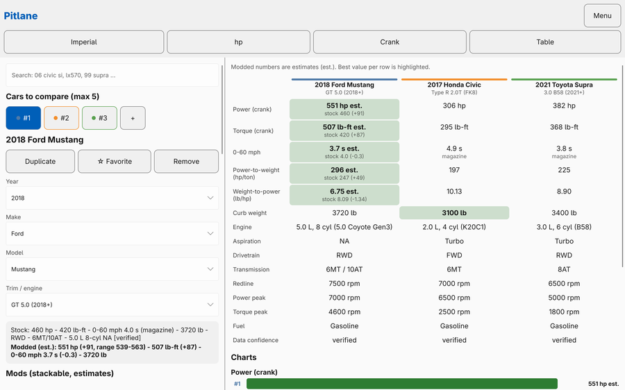
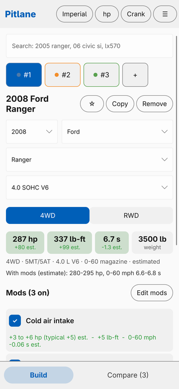
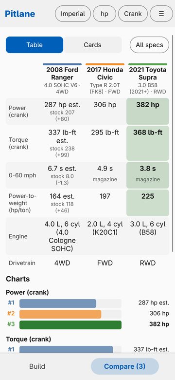

# Pitlane

A car spec comparison tool for Linux, Windows and Android, written entirely in Rust with [Slint](https://slint.dev).
Compare up to 5 cars (US market, 1990-2026), stack mods, and see estimated modded hp, torque and 0-60.

<p>



</p>

## Features
* **Every US-market pickup since 1990** from American and Japanese makes: Ford (F-150, Super Duty, Ranger, Maverick,
  Sport Trac), Chevrolet/GMC (Silverado/Sierra 1500-3500, S-10/Sonoma, Colorado/Canyon, Avalanche, SSR), Dodge/Ram
  (Ram 1500-3500, Dakota), Jeep (Comanche, Gladiator), Cadillac Escalade EXT, Hummer, Lincoln Blackwood/Mark LT,
  Toyota (Pickup, T100, Tacoma, Tundra), Honda Ridgeline, Subaru Baja, Nissan (Hardbody, Frontier, Titan), Mazda
  B-Series, Mitsubishi (Mighty Max, Raider) and Isuzu (Pickup, Hombre, i-Series). A test checks every model year.
* **Drivetrain per trim**: trims sold with more than one drivetrain (2WD / 4WD trucks, optional AWD on sedans and
  crossovers) get a drivetrain switch under the engine picker, with their own weight and 0-60. Search understands
  "awd", "4wd", "4x4" and "2wd".
* **Cascading pickers**: Year → Make → Model → Trim. Changing the year keeps make/model/trim when they still exist that year,
  otherwise resets the first level that doesn't. Changing the make resets model and trim.
* **Up to 5 cars**: add, duplicate (stock vs. modded comparisons), remove. The best value per row is highlighted (nothing is
  highlighted when every car ties).
* **Table and card views**: swipeable cards on phones, a scrollable table on tablets and desktop, and bar charts for power,
  torque, 0-60 and power-to-weight.
* **Mods**: a data-driven mod system (`data/mods.ron`) with aspiration rules (no downpipe/intercooler on NA, no pulley on turbo or
  NA, a turbo kit turns later mods into turbo mods), Stage 1/2 conflicts and requirements, and conditions (altitude, heat,
  passengers, cargo, roof rack, worn engine). Every modded figure is shown as a range and labelled "est.".
* **Units**: imperial/metric, hp/kW/PS, lb-ft/Nm, 0-60 mph or 0-100 km/h, crank or estimated wheel power (drivetrain loss
  is configurable).
* **Fuzzy search**: "06 civic si", "lx570", "'15 sti", "c8 z06". Naming just the car ("ford ranger", "2005 ford ranger")
  gives one result per generation (or one for that year) loaded with its first engine. Adding an engine word ("ranger 4.0",
  "ranger ecoboost", "ranger raptor") picks that engine.
* **Starts empty**: add cars by searching or with "+", then refine them with the pickers.
* **Favorites and saved comparisons.**
* **Your own data**: edit any car's stats (stored as an override), add custom cars, and import/export overrides as text.
* **Export**: text or CSV (copy or save to a file) and PNG.
* Follows the system light/dark theme. Supports keyboard and Android Back.

## Layout
* `crates/pitlane-core`: dataset loader, mod math, units, search, persistence and comparison tables. No UI code.
* `crates/pitlane-app`: Slint UI (`ui/app.slint`), the desktop `main.rs`, and the Android `android_main` entry point in `lib.rs`.
* `data/`: the dataset as RON text, converted at build time by `crates/pitlane-core/build.rs` ([schema](data/README.md)).

## Build
Prerequisites: stable Rust (1.88+). On Linux you also need the usual winit system libraries: fontconfig, xkbcommon, and wayland
and/or xcb. On Ubuntu:
`sudo apt install libxkbcommon-dev libfontconfig1-dev libxcb1-dev libwayland-dev libxcb-render0-dev libxcb-shape0-dev libxcb-xfixes0-dev`.

```bash
cargo build --release            # desktop binary: target/release/pitlane
cargo test --workspace           # core, dataset and a headless end-to-end UI test
cargo clippy --workspace --all-targets -- -D warnings
```

### Linux AppImage (x86_64)
```bash
cargo build --release -p pitlane-app --bin pitlane
mkdir -p AppDir/usr/bin && cp target/release/pitlane AppDir/usr/bin/
cp packaging/pitlane.desktop AppDir/ && cp crates/pitlane-app/assets/icon.png AppDir/pitlane.png
ln -sf usr/bin/pitlane AppDir/AppRun
ARCH=x86_64 appimagetool AppDir Pitlane-x86_64.AppImage   # https://github.com/AppImage/appimagetool
```

### Windows (.exe)
```bash
rustup target add x86_64-pc-windows-msvc
cargo build --release -p pitlane-app --bin pitlane --target x86_64-pc-windows-msvc
```
Release builds use the GUI subsystem, so no console window opens.

### Android (APK, arm64)
```bash
rustup target add aarch64-linux-android
cargo install cargo-apk --locked
export ANDROID_HOME=/path/to/sdk                        # with platforms;android-34 and build-tools;34.0.0
export ANDROID_NDK_ROOT=$ANDROID_HOME/ndk/26.1.10909125
export CARGO_APK_RELEASE_KEYSTORE=/path/to/release.keystore CARGO_APK_RELEASE_KEYSTORE_PASSWORD=...
cargo apk build --release -p pitlane-app --lib --no-default-features --features renderer-femtovg
```
(For a debug APK, drop `--release` and the keystore variables.) The Android settings are under `[package.metadata.android]` in
`crates/pitlane-app/Cargo.toml`. The app stores its data in its private directory (`/data/data/io.github.pitlane.app/files`),
handles rotation without restarting, keeps content clear of the status/navigation bars and the on-screen keyboard, and uses
48 dp touch targets.

### Checking layouts without a device
```bash
cargo run --release -p pitlane-app --example snap -- snapshots/
```
This renders the real UI headlessly at phone (320×568, 360×780, landscape), tablet (800×1280, 1280×800) and desktop sizes, writes
PNGs, and prints full-frame redraw times.

## Releases
Pushing a tag like `v0.1.0` runs `.github/workflows/release.yml`. It tests, builds the AppImage, the Windows exe and the Android
APK, and attaches them to a GitHub Release. A manual run (workflow_dispatch) builds the same artifacts without publishing.
To sign the APK with a stable key (so updates install over older versions), add the repository secrets `ANDROID_KEYSTORE_B64`
(the keystore, base64-encoded) and `ANDROID_KEYSTORE_PASSWORD`. Without them each release is signed with a throwaway key.

## Performance

### Renderer
* **Desktop: the software renderer is the default.** A full-window redraw takes about 1 ms at 1100×760 on a desktop CPU, and in
  practice only changed regions are repainted. It needs no GPU context: VRAM drops from ~75 MB to 0 and resident memory roughly
  halves. Scrolling, picker changes, chart updates and theme switches stay well inside a 60 Hz frame. The GPU renderer is still
  available: `cargo build --release --no-default-features --features renderer-femtovg`.
* **Android: the GPU renderer (FemtoVG, GLES).** A worst-case full-screen software redraw takes 4–6 ms on a desktop core at
  1080×2340 or 2560×1600 (`examples/snap.rs`). Phone cores are roughly 3–8× slower, which would put full-screen scrolling at
  18–50 ms per frame on mid- and low-end phones. Phones share memory between CPU and GPU anyway, so the GPU renderer is kept
  there.

### Measurements
Linux x86_64 (Wayland, AMD GPU). The "after" figures are the released configuration: software renderer on desktop,
`opt-level = "s"`. Idle numbers are sampled over 10 s after startup.

| | before (GPU, as handed off) | before (software) | after (GPU) | **after (software, default)** |
|---|---|---|---|---|
| Startup to first frame | 152–163 ms | 107–118 ms | 147–157 ms | **105–116 ms** |
| Idle RSS | 125 MB | 63 MB | 122 MB | **60 MB** |
| Idle CPU | 0 % | 0 % | 0 % | **0 %** |
| VRAM (amdgpu fdinfo) | 75 MB (+24 MB GTT) | 0 | 75 MB (+24 MB GTT) | **0** |
| Binary size (stripped) | 17.9 MB | 18.2 MB | 14.4 MB | **14.4 MB** |
| Repeating timers while idle | 1 (2 s autosave) | 1 | 0 | **0** |

Dataset (`cargo run --release -p pitlane-core --example bench`):

| | before | after |
|---|---|---|
| Cars | 616 | 664 |
| Decode one make | 26 µs | 1.3 µs |
| Average search | 157 µs | 22 µs |
| First search (builds the cached index) | 200 µs | 0.6 ms |
| Memory after decoding everything | 636 KB | 496 KB |

How these numbers stay low:
* The dataset is a string-interned, fixed-record table embedded in the binary. Car text fields borrow from it
  (`Cow<'static, str>`), so nothing is copied at startup, and makes are decoded lazily.
* Nothing runs while idle. Autosave and search are debounced single-shot timers, and the card-swipe animation only runs during a
  swipe. On Linux the remaining idle wakeups come from the accessibility (D-Bus) and clipboard threads, about 3 per second, at
  0 % CPU.
* Every Slint model is created once and diffed in place, so a slider drag updates only the rows whose text changed.
* Charts are plain rectangles. Images are only rendered for PNG export.

## Data accuracy disclaimer
The dataset was written by hand from commonly published specifications. It was **not** imported from an authoritative database or
machine-checked against sources. `verified` means the hp, torque and weight match the widely published factory figures. A test
(`reference_cars_match_published_figures`) pins well-known cars such as the 2015 Mustang GT, FK8 Civic Type R, 2020/2021 Supra,
C8 Corvette, Hellcat, 2015 WRX STI, Trackhawk, LS400 and NSX. `estimated` means approximate. 0-60 times and curb weights are the
least reliable columns; `source` tells you whether a time is a manufacturer claim, a magazine test or an estimate. Coverage is
broad for popular and performance models but not exhaustive. Modded figures and 0-60 recalculations are rough estimates
(labelled "est."), not predictions for any specific car. You can correct any number in the app; your edits are kept in
`overrides.ron`.

## Extending the dataset
1. Add or edit a generation in the right `data/<group>.ron` file. The format is documented in [data/README.md](data/README.md).
   Mark anything you are unsure of with `conf:Estimated` (the default) and `zs:Est`.
2. Run `cargo test -p pitlane-core`. The build rejects out-of-range values and duplicate ids. The tests reject a trim listed
   twice in the same year, identical cars under different names, and makes with no cars in their listed years.
   `cargo test -p pitlane-core coverage -- --nocapture` prints per-make coverage and the years each make is missing.
3. New mods go in `data/mods.ron`. All of their numbers live there; nothing is hard-coded per mod.

## Known limitations
* The Android clipboard isn't wired up. Use "Save file" in Export, or select and copy the text by hand.
* The dataset is US-market only and not exhaustive.
* The APK is arm64 only.
